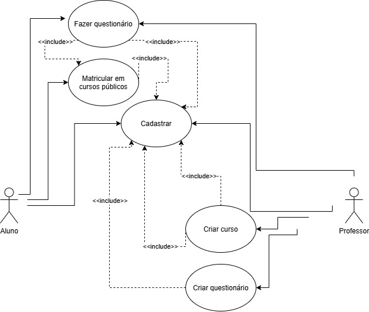
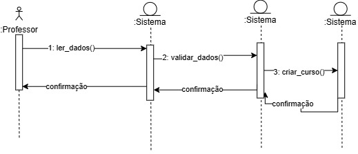
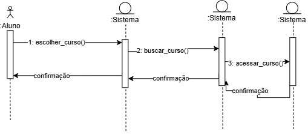
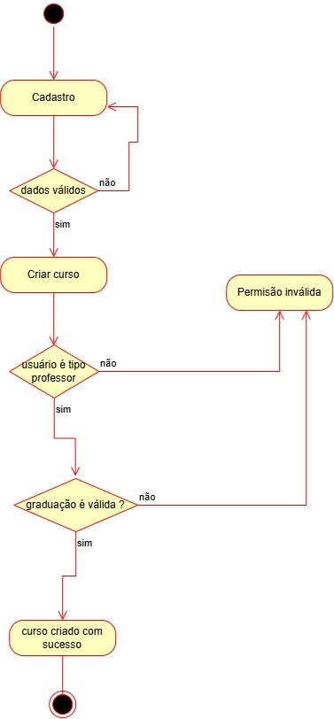

# Introdução
Esse documento tem como objetivo apresentar a especificação do sistema ICET-Cursos, uma plataforma online desenvolvida com a finalidade de promover o compartilhamento de conhecimentos por meio da criação e disponibilização de cursos relacionados às áreas de graduação do Instituto de Ciências Exatas e Tecnologia (ICET). A plataforma busca incentivar a aprendizagem e a troca de conhecimentos entre estudantes e professores, permitindo que diferentes conteúdos acadêmicos sejam disponibilizados de maneira acessível. Além disso, o sistema pretende auxiliar estudantes que desejam aprofundar seus conhecimentos em determinadas áreas ou conhecer novas possibilidades de formação acadêmica e profissional

## Descrição Geral do Software
O ICET-Cursos é uma plataforma online voltada à criação, divulgação e visualização de cursos relacionados às graduações oferecidas pelo Instituto de Ciências Exatas e Tecnologia (ICET). Seu principal objetivo é proporcionar um ambiente de aprendizagem complementar, permitindo que conhecimentos de diferentes áreas sejam compartilhados entre os usuários. O software divide seus usuários em duas categorias: alunos e professores. Os usuários do tipo aluno podem acessar os cursos publicados, realizar matrículas, acompanhar os conteúdos disponibilizados e responder aos questionários associados aos cursos. Já os usuários do tipo professor possuem permissões para criar novos cursos e elaborar questionários, contribuindo para a disponibilização de materiais educacionais na plataforma. É importante destacar que a categoria professor não é restrita exclusivamente a docentes oficialmente vinculados à instituição, podendo incluir estudantes orientados ou auxiliares independentes que estejam aptos a desenvolver e compartilhar conteúdos

## Descrição dos Usuários
O sistema ICET-Cursos possui dois tipos principais de usuários, cada um com responsabilidades e permissões específicas dentro da plataforma:

**Alunos** 

São estudantes do ICET ou estudantes do ensino médio interessados em ampliar seus conhecimentos e explorar diferentes áreas de formação. Esses usuários utilizam a plataforma principalmente para fins de aprendizagem, podendo visualizar os cursos publicados, realizar matrículas, acessar os conteúdos disponibilizados e responder aos questionários para verificar os conhecimentos adquiridos.

**Professores** 

São docentes, estudantes orientados ou auxiliares independentes interessados em compartilhar conhecimentos e promover conteúdos relacionados às áreas de graduação do ICET. Esses usuários possuem permissões para criar cursos e questionários, contribuindo para a formação complementar dos demais participantes e para a divulgação de conhecimentos relacionados às suas áreas de estudo ou pesquisa.

# Requisitos Gerais do Software
## Requisitos Funcionais
| Identificador | Descrição | Pré-condição | Pós-condição | Invariante | Testável | Verificável | Escopo | Prioridade |
|---|---|---|---|---|---|---|---|---|
| RF01 | O sistema deve permitir cadastro de dois tipos de usuário. | Usuário na tela de login. | O usuário acessa o sistema conforme seu nível. | O sistema deve ser acessado. | Sim | Sim | Geral | Essencial |
| RF02 | O sistema deve permitir criação de cursos. | O usuário estar logado e ser do tipo professor. | O curso é criado. | O usuário não pode ser do tipo aluno. | Sim | Sim | Geral | Essencial |
| RF03 | O sistema deve permitir criação de questionários. | O usuário estar logado e ser do tipo professor. | O questionário é criado relacionado a um curso. | O usuário não pode ser do tipo aluno. | Sim | Sim | Geral | Essencial |
| RF04 | O sistema deve permitir visualização dos cursos. | O usuário estar logado e ser de qualquer tipo. | O contador de visualizações incrementa. | O usuário deve estar logado. | Sim | Sim | Geral | Essencial |
| RF05 | O sistema deve permitir fazer os questionários do curso. | O usuário estar logado e ser de qualquer tipo. | O questionário fica marcado como "feito". | O usuário deve estar dentro do curso correspondente. | Sim | Sim | Geral | Essencial |
## Requisitos Não Funcionais
| Identificador | Descrição | Categoria | Testável | Verificável | Escopo | Prioridade |
|---|---|---|---|---|---|---|
| RNF01 | O sistema deve ser intuitivo e com interface limpa. | Interface e Usabilidade | Sim | Sim | Geral | Essencial |
| RNF02 | O sistema deve ter modos de tela "Clara", "Noturna" e "Alto contraste". | Interface e Acessibilidade | Sim | Sim | Geral | Desejável |
| RNF03 | O sistema deve criptografar dados do usuário. | Segurança | Não | Sim | Geral | Importante |
| RNF04 | O sistema deve dividir os usuários em dois tipos. | Usuários | Não | Sim | Geral | Essencial |

## Regras de Negócio
| Identificador | Descrição | Escopo | Prioridade |
|---|---|---|---|
| RN01 | Todo curso deve estar relacionado a uma graduação do ICET. | Geral | Essencial |
| RN02 | Todo curso deve ter um professor em função como criador. | Geral | Essencial |

# Diagramas UML
## Diagramas de Casos de Uso

## Diagramas de Sequência

## Diagramas de Atividades
